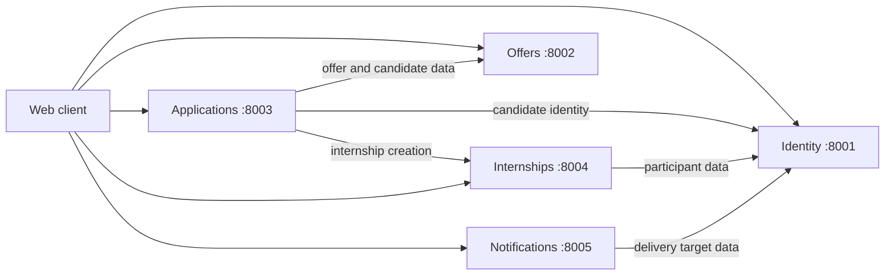

# Architecture

## Overview

STAGELINK is split into five domain services. Each service owns its data and
exposes an HTTP API described by an OpenAPI contract. Services may call each
other, but they never read another service's database.

The diagram shows the intended direction of synchronous calls. Calls marked
"future" below are not implemented yet.

## Service boundaries

| Service         | Owns                                                   | Does not own                         |
| --------------- | ------------------------------------------------------ | ------------------------------------ |
| `identity`      | Accounts, credentials, roles, profiles, sessions/tokens | Offer content, application decisions |
| `offers`        | Company offer content, requirements, visibility, search | Candidate profiles, applications     |
| `applications`  | Applications, status history, decisions, attachments    | Offer content, internship supervision|
| `internships`   | Internship records, supervision, evaluations            | Applications, offer content          |
| `notifications` | Notifications, delivery attempts, user preferences      | Source domain events and entities    |

If a service needs information from another domain, it either calls that
service's API or stores a minimal, explicitly-owned projection. Duplicating a
whole foreign model is not allowed.

## Communication

- **Synchronous:** REST over HTTP using the contracts in `contracts/`. Calls
  have short timeouts, retries only for idempotent operations, and degrade
  gracefully when a dependency is unavailable.
- **Asynchronous:** Domain events are the planned mechanism for notifications
  and other side effects. Events must be versioned and idempotent to consume.
  The message broker is not part of the initial scaffold.

## Data

Each service has its own PostgreSQL database in Docker Compose. The local
fallback for a service run without Docker is SQLite. Cross-service reporting is
not performed directly against service databases; it should use an explicit
read model or data export.

## Authentication

`identity` is the authority for user identity. The target flow is:

1. A client authenticates with `identity` and receives a short-lived access
   token plus a refresh token.
2. The client sends the access token as a bearer token to other services.
3. Services validate token signatures and claims without calling `identity` on
   every request.

The current scaffold exposes only health endpoints. Authentication is the first
planned cross-service capability.

## Configuration

All services read configuration from environment variables. `.env.example`
documents the supported values. Secrets must never be committed; production
values are injected by the deployment platform.

## Operational characteristics

- Every service exposes `GET /health/`.
- Services log to stdout as structured lines suitable for container log
  collection.
- A request that crosses service boundaries should carry a correlation ID once
  the shared middleware is introduced.
- Services are stateless apart from their databases; local files must not be
  treated as durable storage.

## Repository mapping

| Path                  | Purpose                                  |
| --------------------- | ---------------------------------------- |
| `services/<name>/`    | Django project, application and tests    |
| `contracts/<name>.yaml` | Public HTTP interface for the service  |
| `tests/integration/`  | Tests spanning two or more services      |
| `tests/end_to_end/`   | User-journey tests                       |
| `infra/docker/`       | Local container orchestration             |
| `docs/`               | Architecture, conventions and workflows  |
